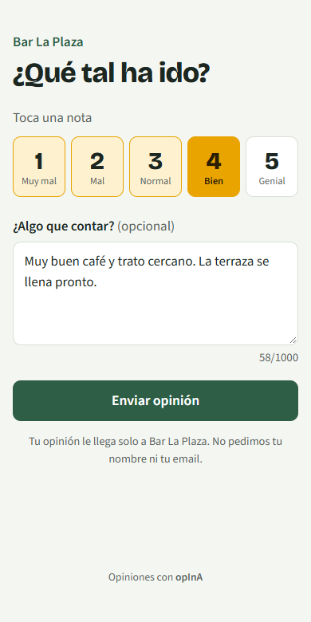
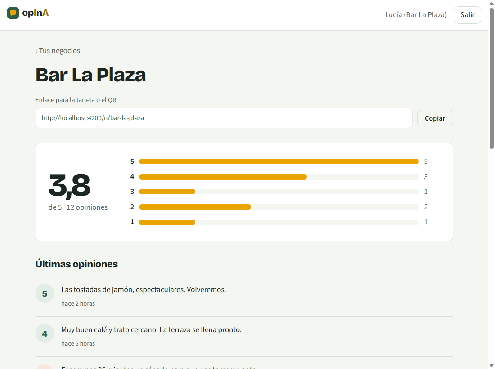

# opInA

[](https://github.com/RaulNuGo06/opina/actions/workflows/ci.yml)

Opiniones de clientes para negocios locales, con resúmenes hechos por IA. El nombre lleva la IA dentro: op**I**n**A**.

El cliente acerca el móvil a una tarjeta NFC o escanea un QR en la mesa, la peluquería o el gimnasio, y deja su opinión en 20 segundos. El negocio ve en un panel qué funciona y qué no. Por ejemplo: *"esta semana seis personas se quejan de la espera de los sábados"*.

> **Estado:** fase 4 de 5. Funcionan el formulario para el cliente, el panel, las cuentas y la IA: cada opinión se clasifica por tema y urgencia, y el panel trae un resumen escrito por Claude. Falta proponer respuestas a las quejas y publicar una demo ([hoja de ruta](#hoja-de-ruta)).

<p align="center">
  
  &nbsp;&nbsp;
  
</p>

## Qué hace ya

### La aplicación (Angular)

- **`/n/{slug}`: el formulario del cliente.** Pensado para el móvil: cinco notas grandes para el pulgar, comentario opcional y, al terminar, el enlace para dejar también la reseña en Google.
- **`/entrar` y `/registro`.**
- **`/panel`: los negocios a los que tienes acceso**, o el alta del primero. El enlace del negocio se genera solo a partir del nombre ("Peluquería Ñandú" pasa a ser `peluqueria-nandu`).
- **`/panel/{slug}`: el panel del negocio.** Nota media, reparto de notas, últimas opiniones con "ver más" (cada una con su tema y, si lo es, marcada como urgente), enlace para copiar a la tarjeta NFC o al QR, y quién tiene acceso (solo lo ve el dueño).
- **"Lo que dicen tus clientes"**, dentro del panel: un resumen escrito por la IA, las opiniones que conviene atender cuanto antes y de qué temas se habla, en los últimos 7, 30 o 90 días.

### La API

**Para el cliente que opina** (sin cuenta):

| Método | Ruta | Para qué |
|---|---|---|
| `GET` | `/api/negocios/{slug}` | Nombre del negocio, para el formulario |
| `POST` | `/api/negocios/{slug}/opiniones` | Guarda una opinión (nota de 1 a 5 y comentario opcional) |

**Para el negocio** (con sesión: `Authorization: Bearer <token>`):

| Método | Ruta | Quién | Para qué |
|---|---|---|---|
| `POST` | `/api/auth/registro` · `/api/auth/login` | Cualquiera | Crear cuenta o entrar. Devuelve un token JWT válido 8 horas |
| `GET` | `/api/yo` | Con sesión | Mis datos y los negocios a los que tengo acceso |
| `POST` | `/api/negocios` | Con sesión | Dar de alta un negocio; quien lo crea queda como dueño |
| `GET` | `/api/negocios/{slug}/opiniones?pagina=0&tamano=20` | Dueño o empleado | Opiniones de la más nueva a la más antigua |
| `GET` | `/api/negocios/{slug}/opiniones/resumen` | Dueño o empleado | Total, nota media y cuántas hay de cada nota |
| `GET` | `/api/negocios/{slug}/opiniones/informe?dias=7` | Dueño o empleado | Temas, opiniones urgentes y resumen escrito por la IA |
| `GET` `POST` `DELETE` | `/api/negocios/{slug}/miembros` | Dueño | Ver, añadir o quitar empleados |

La documentación interactiva (Swagger UI) está en `/docs`. Para probar lo privado, entra con `/api/auth/login`, copia el token y pégalo en el botón **Authorize**.

```bash
curl -X POST localhost:8080/api/negocios/bar-la-plaza/opiniones \
  -H 'Content-Type: application/json' \
  -d '{"puntuacion": 2, "comentario": "Mucha espera en la terraza"}'
```
```json
{ "id": "a656f49e-…", "urlResenaGoogle": "https://search.google.com/local/writereview?placeid=…" }
```

Los errores siguen el estándar Problem Details (RFC 9457) e indican qué campo falla, para que el formulario pueda marcarlo:

```json
{
  "status": 400,
  "detail": "Hay datos que no son válidos",
  "errores": { "puntuacion": "La puntuación va de 1 a 5" }
}
```

## Decisiones técnicas

### IA (Claude)

- **El cliente nunca espera a la IA.** Opinar responde al momento; un proceso en segundo plano recoge cada pocos segundos las opiniones pendientes y las clasifica con Claude: tema, sentimiento y si es urgente.
- **Varias instancias sin pisarse.** Cada opinión se coge con `SELECT … FOR UPDATE SKIP LOCKED` en su propia transacción, así dos servidores nunca clasifican la misma. Un índice parcial (`where estado_ia = 'PENDIENTE'`) mantiene la búsqueda rápida aunque haya muchas opiniones.
- **Si la IA falla, no se insiste.** La vuelta se detiene al primer error (lo normal es que la API esté caída o saturada) y se reintenta en la siguiente; al tercer fallo esa opinión se deja como `FALLIDA`. Las opiniones sin comentario no gastan ninguna llamada.
- **Temas de una lista cerrada.** La respuesta de Claude se fuerza a un esquema JSON derivado de un `record` de Java (salidas estructuradas), así solo puede devolver temas que el panel sabe contar y comparar.
- **El texto del cliente es un dato, no instrucciones.** Va dentro de etiquetas, el prompt de sistema lo dice expresamente, y la salida estructurada limita lo que puede volver. Un cliente que escribe "ignora tus instrucciones" solo consigue una opinión más.
- **El resumen no se paga dos veces.** Se guarda con una "huella" de las opiniones del periodo y solo se vuelve a pedir si entra una opinión nueva o la IA termina de clasificar alguna. Si Claude falla, se enseña el último resumen guardado.
- **Sin clave de API, todo sigue funcionando**: el panel muestra las cifras y no aparece el resumen. Los tests usan un asistente falso detrás de la interfaz `AsistenteIa`, así que la CI no hace llamadas reales ni gasta dinero.
- **Coste y modelo.** Por defecto `claude-opus-5-5` con esfuerzo bajo para clasificar y medio para resumir. Se cambia con `OPINA_IA_MODELO` sin tocar código (por ejemplo, `claude-haiku-5-5` para gastar menos). Las peticiones activan el *fallback* del servidor: si un filtro de seguridad rechaza una, la API la reintenta con otro modelo.

### Seguridad

- **JWT firmado por la propia API con el resource server de Spring Security**, sin librerías de terceros. El secreto llega por la variable `JWT_SECRET` y nunca está en el código. Si falta, se genera uno aleatorio al arrancar y se avisa en el log, así no se puede desplegar sin querer con un secreto conocido.
- **El token solo dice quién eres, no qué puedes hacer.** Los permisos se consultan en cada petición, así que quitar a un empleado le corta el acceso al momento aunque su token siga vigente. Hay un test que lo comprueba (`alQuitarAUnEmpleadoPierdeElAccesoAlMomentoAunqueSuTokenSigaVigente`).
- **Los permisos están en un solo sitio** (`ControlAcceso`): todos los servicios del panel pasan por él. 401 si no hay sesión, 403 si no eres del negocio y "solo el dueño" para gestionar miembros.
- **El login no delata qué emails tienen cuenta.** El mensaje de error es el mismo si falla el email o la contraseña, y se calcula un hash aunque el email no exista, para que el tiempo de respuesta tampoco lo revele.
- **Contraseñas con BCrypt** y el prefijo `{bcrypt}`: si un día se cambia de algoritmo, los hashes antiguos siguen valiendo. Mínimo 10 caracteres y máximo 72, que es lo que BCrypt usa de verdad.
- **Solo se puede añadir como empleado a quien ya tiene cuenta**, así nadie recibe una contraseña elegida por otra persona.
- **Sin CSRF ni sesiones en el servidor:** el token viaja en la cabecera `Authorization`, no en una cookie.

### Frontend

- **Angular 22 sin zone.js, con signals y componentes standalone.** Cada pantalla se descarga solo cuando se visita (*lazy loading*), así el cliente que opina no descarga el código del panel.
- **Las reglas de validación están solo en el servidor.** El formulario de registro no las repite; muestra los mensajes que devuelve la API debajo de cada campo. Así no hay dos versiones de las reglas que puedan contradecirse.
- **Un interceptor añade el token a las llamadas a `/api/`** y a nada más. Si el servidor responde 401, cierra la sesión y lleva a entrar, recordando a qué página se quería ir. La vuelta solo acepta rutas del panel, para que un enlace manipulado no pueda llevar a otra web.
- **El token se guarda en `localStorage`** para no perder la sesión al recargar. El precio es que un fallo de XSS podría leerlo. Angular escapa todo lo que pinta y la app no usa `innerHTML`; el siguiente paso sería pasar a una cookie `HttpOnly`.
- **Accesible:** las notas son botones de opción de verdad (se pueden usar con teclado y lector de pantalla), cada campo tiene su etiqueta, se respeta el modo oscuro del sistema y la preferencia de reducir animaciones.

### Datos y API

- **Sin filtrar a los clientes descontentos.** Muchas herramientas de reseñas solo mandan a Google a quien pone 4 o 5 estrellas. Eso se llama *review gating* y va contra las normas de Google. opInA devuelve el enlace de reseña sea cual sea la nota, y hay un test que lo comprueba (`tambienOfreceGoogleAQuienPuntuaBajo`). El valor para el negocio está en entender las opiniones, no en esconderlas.
- **El esquema lo controla Flyway, no Hibernate.** Las tablas, restricciones (`puntuacion between 1 and 5`, formato del slug) e índices se definen en SQL versionado. Hibernate arranca en modo `validate` y falla si las entidades no encajan con la base de datos.
- **Tests contra PostgreSQL real.** Testcontainers levanta la misma versión que en producción, así que lo que se prueba es lo que se despliega. Cada test crea su propio negocio, de modo que no dependen unos de otros. Uno de ellos comprueba que las opiniones de un negocio no aparecen en otro.
- **Validación en dos capas.** Bean Validation da mensajes claros a quien usa la API, y las restricciones de la base de datos protegen los datos aunque alguien se salte la API.
- **Organización por funcionalidad** (`negocio/`, `opinion/`) en lugar de por capas, para que cada parte se entienda leyendo una sola carpeta.

## Cómo arrancarlo

Necesitas Java 21, Node 24 y PostgreSQL 17. Lo más sencillo para tener PostgreSQL es Docker:

```bash
docker compose up -d                                   # PostgreSQL en localhost:5432
./mvnw spring-boot:run -Dspring-boot.run.profiles=demo # API en localhost:8080

cd frontend && npm install && npm start                # App en localhost:4200 (las llamadas a /api van a la API)
```

Abre `http://localhost:4200/n/bar-la-plaza` para opinar como cliente y `http://localhost:4200/panel` para ver el panel.

El perfil `demo` carga **Bar La Plaza**, un bar inventado con 12 opiniones de ejemplo, y la cuenta de su dueña:

- Email: `dueno@barlaplaza.demo`
- Contraseña: `demo-opina-2026`

Las opiniones de ejemplo ya vienen clasificadas, así que el panel enseña temas y urgencias aunque no tengas clave de API. Para ver el resumen escrito por la IA y que se clasifiquen las opiniones nuevas, arranca la API con tu clave:

```bash
ANTHROPIC_API_KEY=sk-ant-... ./mvnw spring-boot:run -Dspring-boot.run.profiles=demo
```

Variables de entorno: `DB_URL`, `DB_USER`, `DB_PASSWORD`, `JWT_SECRET` (al menos 32 caracteres), `ANTHROPIC_API_KEY` (opcional), `OPINA_IA_MODELO` (por defecto `claude-opus-5-5`) y `OPINA_IA_INTERVALO` (cada cuánto se clasifican las nuevas, por defecto `PT10S`).

### Tests

```bash
./mvnw test                                                      # API, con Docker
DB_URL=jdbc:postgresql://localhost:5432/opina_test ./mvnw test   # API, sin Docker, contra un PostgreSQL propio
cd frontend && npx ng test --watch=false                         # App (Vitest)
```

## Tecnologías

- **Backend:** Java 21 · Spring Boot 4.1 · Spring Security (OAuth2 Resource Server, JWT) · Spring Data JPA (Hibernate) · PostgreSQL 17 · Flyway · Bean Validation · springdoc-openapi
- **IA:** API de Claude con el SDK oficial de Java (salidas estructuradas, *fallback* del servidor)
- **Frontend:** Angular 22 (signals, standalone, sin zone.js) · TypeScript · Reactive Forms · CSS propio, sin librerías de componentes
- **Calidad:** JUnit 5 · AssertJ · Testcontainers · Vitest · Prettier · GitHub Actions

## Hoja de ruta

- [x] **Fase 1:** API de negocios y opiniones, validación, tests y CI
- [x] **Fase 2:** cuentas de negocio con Spring Security y JWT (dueño y empleado); el listado y el resumen pasan a ser privados
- [x] **Fase 3:** formulario público y panel del negocio en Angular
- [x] **Fase 4:** IA con la API de Claude: tema, sentimiento y urgencia de cada opinión, y resumen de los últimos días
- [ ] **Fase 5:** propuesta de respuesta a cada queja, escrita por la IA y editable por el dueño
- [ ] Despliegue con una demo pública

## Autor

**Raúl Núñez González**: [portfolio](https://raulnugo06.github.io) · [LinkedIn](https://www.linkedin.com/in/ra%C3%BAl-n%C3%BA%C3%B1ez-gonz%C3%A1lez-17032a389) · [GitHub](https://github.com/RaulNuGo06)
